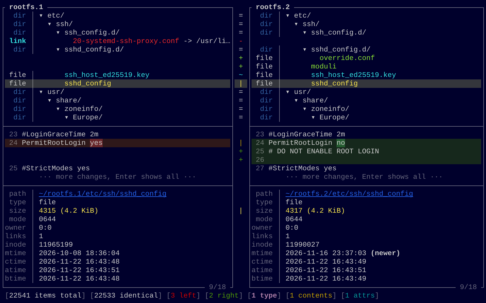
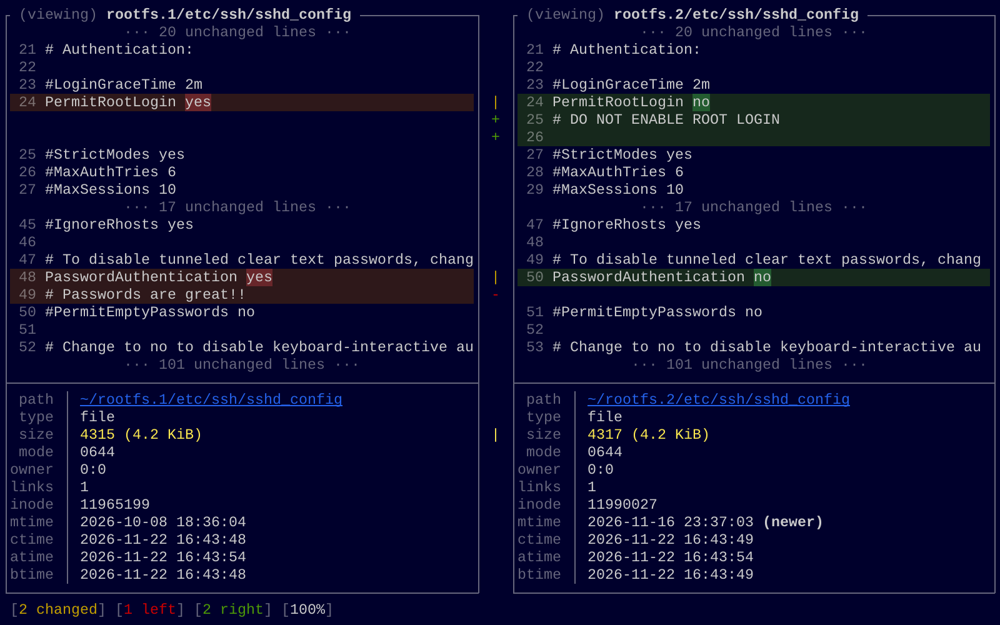
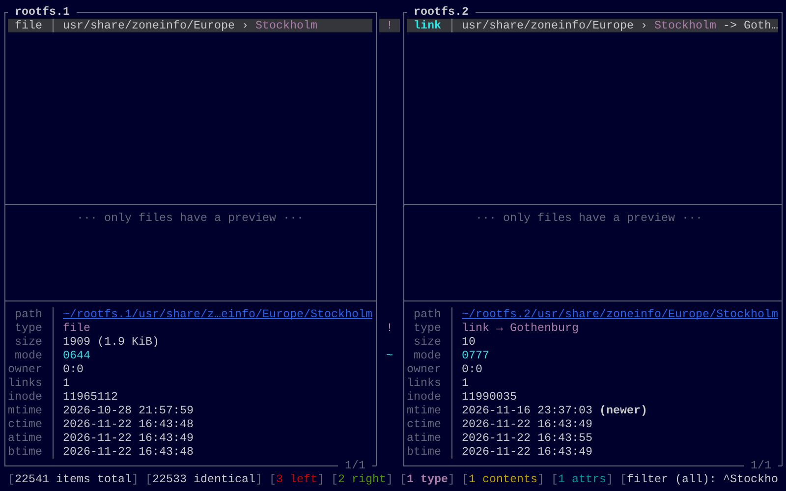
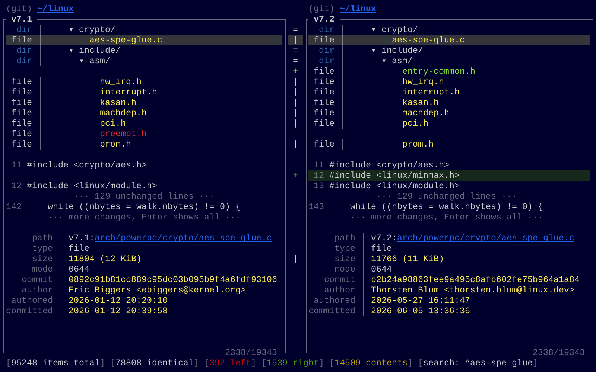

<!--
SPDX-FileCopyrightText: 2026 Philip Eklöf

SPDX-License-Identifier: MIT
-->

# binate

binate compares two directory trees side by side in the terminal, or two
revisions of a git repository. It highlights differences in file contents and
metadata, and opens text files in a diff view to inspect them line by line.

## Features

### Parallel tree comparison

Both trees are scanned in parallel, and entries are paired by name. A mark
between the two sides indicates differences in contents, mode, owner, mtime or
type, or shows that an entry exists on only one side. You choose which
differences matter, and `-q` compares by size and mtime instead of reading file
contents.

Each entry is compared according to its type. Regular files are compared by
their contents, symlinks by their targets, block and character devices by their
major and minor numbers, and FIFOs and sockets by their type. Symlinks in the
trees are never followed, and special files in them are never opened.



Panels under each side show the selected entry's details and highlight
differences. A preview shows the first differences between the selected files
before you open the diff view.

### File diffing

`Enter` opens two text files side by side, with word-level highlights inside
changed lines.



### Navigation and search

Jump between differences, hide identical entries, or filter and search entry
names using regular expressions or literal text. Filtering covers the whole
tree.



### Native git object reader

Use `-g` to compare two revisions or files within them. Data is read directly
from the repository without running git or checking anything out. Files are
compared by their object IDs without reading their contents. Two revisions of
Linux compare in about 0.2 seconds.

The panels on both sides show the commit that last changed each entry.



### Read-only, escaped output and Landlock sandbox

binate never changes files itself. Press `e` to open a file in your editor.
Control characters, bidi overrides and invisible characters in names and
contents are shown escaped, never sent to the terminal. Landlock prevents the
process that reads files from writing files or running programs, and restricts
some network access. With `-g`, it also prevents reads outside the repository.

### difftool, editor and terminal integration

binate works as a `git difftool`, opens your `$VISUAL` or `$EDITOR`, and follows
the terminal's palette, with colours changed through `BINATE_COLORS` or turned
off with `NO_COLOR`.

## Examples

Compare two directory trees:

```
$ binate ~/src/old ~/src/new
```

Check a backup against the originals quickly, by size and modification time
instead of contents:

```
$ binate -q /mnt/backup ~/photos
```

Compare a local file with one on another host using process substitution:

```
$ binate config.yaml <(ssh host cat /etc/app/config.yaml)
```

Use binate as git's difftool, which opens each changed file in turn:

```
$ git difftool --no-prompt -x binate
```

Compare two branches of the git repository you're in:

```
$ binate -g main feature
```

Press `?` to list the current screen's key bindings, or run `binate --help` to
list command-line options. [binate(1)](doc/binate.1.md) summarises both, and the
[manual](doc/manual.md) describes everything in detail.

## Requirements

binate requires Linux and a terminal. Sandbox protection depends on the kernel,
and network restrictions are partial. Without Landlock, binate runs unprotected.
`-v` reports the Landlock ABI in effect; see the
[manual](doc/manual.md#landlock) for the restrictions each ABI provides.


## Building and testing

```
make            # build/binate
make test       # unit and end-to-end tests
make vet        # go vet
make man        # the man pages in build/man/, requires go-md2man
make fuzz       # all fuzz targets, FUZZTIME=10s by default
staticcheck ./...
```

The build targets x86-64-v3 CPUs (roughly 2013 and later) by default.
`make GOAMD64=v1` can be used for older CPUs.

`make man` builds binate(1) from [doc/binate.1.md](doc/binate.1.md) and
binate-manual(7) from [doc/manual.md](doc/manual.md). Install
[go-md2man](https://github.com/cpuguy83/go-md2man) with your package manager or
`go install github.com/cpuguy83/go-md2man/v2@v2.0.7`, and read the results with
`man -l build/man/binate.1` and `man -l build/man/binate-manual.7`. A page's
footer date defaults to the last commit date of its Markdown source. Set
`MAN_DATE=YYYY-MM-DD` when building without Git metadata.

binate has no TUI library: the terminal layer is written on `golang.org/x/term`
and `golang.org/x/sys`. `go-landlock` provides the sandbox. The line diff is
Go's `internal/diff`, changed to return line operations (BSD-3-Clause, see
[LICENSES](LICENSES)).

See [doc/CONTRIBUTING.md](doc/CONTRIBUTING.md) for conventions and
[doc/testing.md](doc/testing.md) for what the tests cover.

## Acknowledgements

Inspired by [duodiff](https://github.com/akunzai/duodiff), a similar tool that
allows merging and synchronization of files and directories, while binate
focuses on sandboxed read-only comparison.
